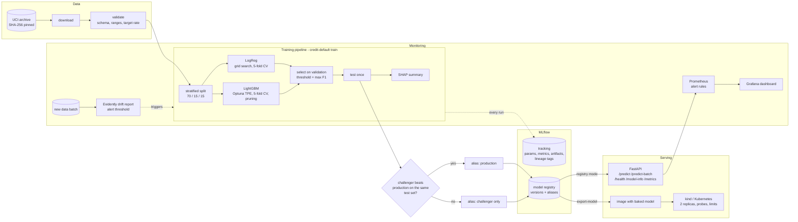
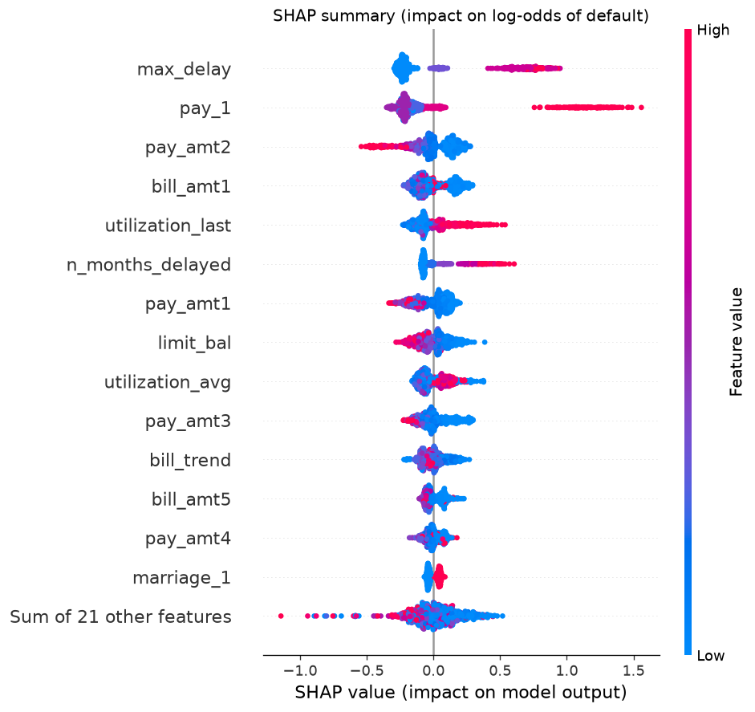

# Credit default MLOps pipeline

An end-to-end MLOps project for a tabular classifier that predicts whether a credit-card
client will default on next month's payment. It covers the whole lifecycle: validated
data, reproducible training with tracked experiments, a model registry with
champion/challenger promotion, explainability, a containerised inference API, Kubernetes
deployment, CI/CD/CT on GitHub Actions, and production monitoring with drift detection.

The model is deliberately ordinary (logistic regression vs. LightGBM). The engineering
around it is the point of the project.

---

## Contents

- [Problem and data](#problem-and-data)
- [Architecture](#architecture)
- [Results](#results)
- [How each requirement is met](#how-each-requirement-is-met)
- [Run it locally](#run-it-locally)
- [CI/CD/CT](#cicdct)
- [Monitoring and drift](#monitoring-and-drift)
- [Project layout](#project-layout)
- [Design decisions and limitations](#design-decisions-and-limitations)
- [How I used AI tools](#how-i-used-ai-tools)

---

## Problem and data

A lender wants a probability that each customer defaults next month so it can prioritise
collections or adjust credit limits. This is binary classification with class imbalance:
22.1% of customers default.

**Dataset:** _Default of Credit Card Clients_, Taiwan, April–September 2005. 30,000 rows,
23 features: credit limit, demographics, six months of repayment status, bill amounts and
payment amounts.

- Source: UCI Machine Learning Repository, dataset 350,
  <https://archive.ics.uci.edu/dataset/350/default+of+credit+card+clients>
- Citation: Yeh, I. (2009). _Default of Credit Card Clients_ [Dataset]. UCI Machine
  Learning Repository. <https://doi.org/10.24432/C55S3H>
- Original paper: Yeh, I. C., & Lien, C. H. (2009). The comparisons of data mining
  techniques for the predictive accuracy of probability of default of credit card
  clients. _Expert Systems with Applications_, 36(2), 2473–2480.
- **Licence: [Creative Commons Attribution 4.0 (CC BY 4.0)](https://creativecommons.org/licenses/by/4.0/)**

The data is **not committed**. `credit-default download` fetches the UCI archive, checks
its SHA-256 against a pinned value, and writes a tidy CSV to `data/raw/` (gitignored).
Columns are renamed to `snake_case`, and `PAY_0` becomes `pay_1` so the three monthly
column families line up.

---

## Architecture



| Environment       | Model source                                                        | Purpose                                    |
| ----------------- | ------------------------------------------------------------------- | ------------------------------------------ |
| Local dev         | `sqlite:///mlflow.db` + `./mlruns`                                  | fast iteration, tests                      |
| docker-compose    | MLflow server container (registry + proxied artifacts)              | full local stack incl. Prometheus/Grafana  |
| Kubernetes (kind) | model exported from the registry and baked into the image           | immutable, no runtime dependency on MLflow |
| GitHub Actions    | ephemeral SQLite registry, persisted between CT runs as an artifact | CI, CD smoke test, scheduled retraining    |

---

## Results

All numbers below come from the real run on the full dataset, `credit-default train
--n-trials 40`, logged in MLflow. Nothing is hand-edited. Split: 21,000 train / 4,500
validation / 4,500 test, stratified, seed 42.

| Model                                      | 5-fold CV ROC-AUC (train) | Validation ROC-AUC | Validation PR-AUC |
| ------------------------------------------ | ------------------------- | ------------------ | ----------------- |
| Logistic regression (best `C = 10`)        | 0.7595 ± 0.0109           | 0.7687             | 0.5370            |
| **LightGBM** (Optuna, 40 trials, 5 pruned) | **0.7876 ± 0.0104**       | **0.7916**         | **0.5751**        |

The selected model, LightGBM, was evaluated **once** on the held-out test set. The
decision threshold of 0.288 was chosen on validation by maximising F1.

| Test metric                     | Value                    |
| ------------------------------- | ------------------------ |
| ROC-AUC                         | **0.7876**               |
| PR-AUC (average precision)      | 0.5741                   |
| F1 / precision / recall @ 0.288 | 0.5511 / 0.5345 / 0.5688 |
| Accuracy @ 0.288                | 0.7951                   |
| Log loss / Brier score          | 0.4230 / 0.1325          |

For context, published results on this dataset are typically around 0.77–0.80 ROC-AUC.
The limit is the information in the features (no income or credit-bureau data), not the
model class. A trivial "never defaults" model would score 77.9% accuracy, which is why
accuracy is not the selection metric.

**Explainability (SHAP, 1,000 test rows, registered model):**



The most recent repayment status (`pay_1`) and the engineered `max_delay` /
`n_months_delayed` dominate. Larger recent payments (`pay_amt1`, `pay_amt2`) and higher
credit limits lower risk, and high utilisation raises it. These directions match domain
intuition, which is a useful sanity check. SHAP values are on the log-odds scale and
explain the model, not causality.

### Verification log

What was actually run, and what it showed. Local runs were on a 4-core Windows laptop
with about 3.7 GB of RAM for Docker.

| Check                                                      | Outcome                                                                                                                                                                                                              |
| ---------------------------------------------------------- | -------------------------------------------------------------------------------------------------------------------------------------------------------------------------------------------------------------------- |
| GitHub Actions `CI/CD` (first push)                        | lint, typecheck, tests, image build, and **deploy-kind** all green. CD trained a quick model, baked it into the image, rolled out 2 replicas on kind and passed the smoke test through the NodePort (job time 154 s) |
| Docker: `api-with-model`, read-only root FS, non-root      | smoke test passed; same score (0.084228 for the example request) as the model served by the registry                                                                                                                 |
| Local kind (1 replica to fit the laptop)                   | pod `1/1 Running`, smoke test passed via `localhost:30080`. Needed the startup-probe budget and probe timeouts now in the manifest                                                                                   |
| docker-compose: trainer → MLflow server                    | 10 Optuna trials. LR CV/val ROC-AUC identical to the local run (0.7595 / 0.7687); LightGBM CV 0.7860, val 0.7904, **test 0.7881**. Registered as v1 and promoted, with `git_commit` lineage set                      |
| docker-compose: API ← registry                             | started with no model (`/health` 503, `RESOURCE_DOES_NOT_EXIST`), then loaded `@production` by itself on its retry loop, with no restart                                                                             |
| Prometheus during replayed traffic (753 requests at 8 rps) | p50 / p95 `/predict` latency 140 / 453 ms. Mean predicted P(default) ≈ 0.22 on clean traffic, **0.396** during downturn traffic (above the alert band). 16 invalid requests counted as 422                           |
| Grafana                                                    | datasource and the "Credit default API" dashboard auto-provisioned                                                                                                                                                   |
| GitHub Actions `Continuous training`, run 1                | no saved registry yet, so drift check skipped; trained, registered v1, promoted ("no production model yet"); registry saved as an artifact                                                                           |
| GitHub Actions `Continuous training`, run 2                | restored the registry from run 1; **drift alert raised** on the simulated downturn batch; retrained with a new search seed, registered v2 (test ROC-AUC 0.7846); **gate rejected it**: "challenger 0.7846 vs champion 0.7878 (min_delta 0.001) -> keep champion", so production stayed on v1|

---

## How each requirement is met

| Requirement                                                 | Implementation                                                                                                                                                                                              | Where                                                         |
| ----------------------------------------------------------- | ----------------------------------------------------------------------------------------------------------------------------------------------------------------------------------------------------------- | ------------------------------------------------------------- |
| Python package, `src/` layout, type hints, ruff, pytest     | `uv`-managed package, `mypy --strict` clean, ruff lint + format, ~45 tests                                                                                                                                  | `pyproject.toml`, `src/credit_default/`, `tests/`             |
| Data validation                                             | required columns, dtypes, nulls, value domains from the dataset docs, value ranges, target rate bounds, duplicate check; hard errors stop the run, warnings are logged to MLflow                            | `validation.py`                                               |
| Preprocessing + feature engineering in a sklearn `Pipeline` | `FeatureEngineer` (utilisation, payment ratio, bill trend, delay counts, undocumented code folding) then `ColumnTransformer` (one-hot + scaling) then estimator                                             | `features.py`                                                 |
| Train / validation / test split                             | stratified 70/15/15 with a fixed split seed                                                                                                                                                                 | `data.py::split_dataset`                                      |
| Baseline + stronger model                                   | logistic regression and LightGBM                                                                                                                                                                            | `models.py`                                                   |
| Hyperparameter tuning                                       | `GridSearchCV` for LR; Optuna TPE + median pruner for LightGBM                                                                                                                                              | `models.py`                                                   |
| Validation strategy                                         | stratified 5-fold CV on train for tuning; validation split for model selection and threshold; test split used once                                                                                          | `train.py`                                                    |
| MLflow tracking                                             | nested runs (pipeline, model, one per Optuna trial): params, CV/val/test metrics, search history, validation report, SHAP plots, model with signature and input example                                     | `train.py`                                                    |
| Model registry, versions, production alias                  | every training run registers a version; `challenger` alias on each new version; `production` moves only through the promotion gate                                                                          | `registry.py`                                                 |
| Lineage                                                     | dataset content hash (SHA-256), source URL, DOI and licence, git commit / branch / dirty flag, library versions, as run tags and model-version tags; MLflow dataset input logging                           | `lineage.py`, `data.py::dataset_fingerprint`                  |
| Explainability                                              | SHAP TreeExplainer (or LinearExplainer if LR wins): beeswarm, bar and mean-\|SHAP\| CSV logged under `explainability/`                                                                                      | `explain.py`                                                  |
| FastAPI service                                             | `/predict`, `/predict-batch` (≤ 1,000 records), `/health` (readiness), `/health/live`, `/model-info`, `/metrics`; Pydantic v2 schemas with bounds kept in sync with training validation by a test           | `serving/`                                                    |
| Unit + API tests                                            | data, validation, features, metrics, API contract, input validation, metrics exposure, end-to-end train → register → gate → export, drift                                                                   | `tests/`                                                      |
| Multi-stage Docker image                                    | uv builder stages, slim non-root runtime, `api` / `api-with-model` / `trainer` targets                                                                                                                      | `Dockerfile`                                                  |
| docker-compose                                              | MLflow server, API, trainer (profile), Prometheus, Grafana                                                                                                                                                  | `docker-compose.yml`                                          |
| Kubernetes on kind                                          | Deployment (2 replicas, rolling update with `maxUnavailable: 0`, startup / liveness / readiness probes, requests and limits, non-root, read-only root FS), NodePort Service, PodDisruptionBudget, kustomize | `deploy/k8s/`, `deploy/kind/`                                 |
| CI                                                          | ruff, mypy, pytest (unit + slow end-to-end), Docker builds with layer caching, on every push and PR                                                                                                         | `.github/workflows/ci.yml`                                    |
| CD                                                          | on `main`: quick train, export the production model, build the image, create a kind cluster, deploy, roll out, smoke test through the Service                                                               | `ci.yml` → `deploy-kind`                                      |
| CT                                                          | weekly and manual: restore registry, drift check, retrain with a new search seed, gate-promote, persist registry                                                                                            | `.github/workflows/retrain.yml`                               |
| Prometheus metrics + Grafana                                | request count and latency histograms per route template, prediction probability histogram, predicted-class counter, model-loaded and version gauges; provisioned dashboard and alert rules                  | `serving/metrics.py`, `deploy/prometheus/`, `deploy/grafana/` |
| Drift report with alert threshold                           | Evidently `DataDriftPreset` on features and model scores against a training reference; alert when drifted-feature share > threshold or the prediction distribution drifts; exit code 2 for automation       | `monitoring/drift.py`                                         |

---

## Run it locally

Prerequisites: [uv](https://docs.astral.sh/uv/) ≥ 0.13, Docker, and for Kubernetes
[kind](https://kind.sigs.k8s.io/) and `kubectl`. uv installs Python 3.12 itself if it's
missing.

### 1. Train, track and register (no Docker)

```bash
uv sync --all-extras                 # create .venv from uv.lock
uv run credit-default download       # fetch + checksum the UCI data
uv run credit-default validate       # print the validation report
uv run credit-default train --n-trials 40 --summary-out reports/summary.json
uv run mlflow ui --backend-store-uri sqlite:///mlflow.db   # http://localhost:5000
```

A full 40-trial run took about 42 minutes on a 4-core laptop. `--n-trials 5 --cv-folds 3`
is enough to try the flow. Running `train` again registers a new version, which is only
promoted if it beats the current `production` version by more than `--min-delta`
(default 0.001 ROC-AUC) on the same test set.

Serve the registered model directly:

```bash
uv run uvicorn credit_default.serving.app:app --port 8000
# docs: http://localhost:8000/docs
curl -s localhost:8000/predict -H 'Content-Type: application/json' \
  -d '{"limit_bal":50000,"sex":2,"education":2,"marriage":1,"age":35,
       "pay_1":0,"pay_2":0,"pay_3":0,"pay_4":0,"pay_5":0,"pay_6":0,
       "bill_amt1":30000,"bill_amt2":28000,"bill_amt3":26000,"bill_amt4":24000,
       "bill_amt5":22000,"bill_amt6":20000,"pay_amt1":2000,"pay_amt2":2000,
       "pay_amt3":2000,"pay_amt4":2000,"pay_amt5":2000,"pay_amt6":2000}'
```

### 2. Full stack with docker-compose

```bash
docker compose up -d --build                     # MLflow :5000, API :8000, Prometheus :9090, Grafana :3000
docker compose --profile train run --rm trainer  # train against the MLflow server, register, gate-promote
docker compose restart api                       # API resolves models:/credit-default-classifier@production
python scripts/smoke_test.py --url http://localhost:8000
```

The API starts even before a model exists. `/health` returns 503 and the service retries
loading every 15 s, so start-up order does not matter.

### 3. Kubernetes on kind

```bash
# 1. export the production model and bake it into an immutable image
uv run credit-default export-model --alias production --out build/model-export
docker build --target api-with-model -t credit-default-api:with-model .

# 2. cluster + deploy
kind create cluster --config deploy/kind/kind-config.yaml
kind load docker-image credit-default-api:with-model --name credit-default
kubectl apply -k deploy/k8s
kubectl -n credit-default rollout status deployment/credit-default-api

# 3. test through the NodePort (mapped to localhost:30080 by the kind config)
python scripts/smoke_test.py --url http://localhost:30080

# useful
kubectl -n credit-default get pods,svc,pdb
kubectl -n credit-default logs -l app.kubernetes.io/name=credit-default-api
kind delete cluster --name credit-default
```

### 4. Tests and checks

```bash
uv run ruff check src tests scripts && uv run ruff format --check src tests scripts
uv run mypy
uv run pytest -m "not slow"     # unit + API (~1 min)
uv run pytest -m slow           # end-to-end train/register/gate/export on synthetic data
```

---

## CI/CD/CT

| Workflow                               | Trigger                      | What it does                                                                                                                                                                                                                                            |
| -------------------------------------- | ---------------------------- | ------------------------------------------------------------------------------------------------------------------------------------------------------------------------------------------------------------------------------------------------------- |
| `ci.yml` → `lint`, `typecheck`, `test` | every push and PR            | ruff, `mypy --strict`, pytest with coverage (the slow end-to-end test included)                                                                                                                                                                         |
| `ci.yml` → `build`                     | after the checks pass        | builds the `api` and `trainer` images with BuildKit layer caching (no push)                                                                                                                                                                             |
| `ci.yml` → `deploy-kind` (CD)          | push to `main`               | trains a quick model into a throw-away registry, exports `production`, builds `api-with-model`, creates a kind cluster, deploys with kustomize, waits for the rollout, runs `scripts/smoke_test.py` against the NodePort, and dumps pod logs on failure |
| `retrain.yml` (CT)                     | Mondays 04:00 UTC and manual | restores the registry from the last successful run, runs the drift check against the current production model, retrains with a new search seed, applies the promotion gate, writes a job summary, and saves the registry for the next run               |

**Why the registry is an artifact in CI.** A hosted MLflow server costs money. The CT
workflow therefore carries its SQLite registry from run to run as a workflow artifact
(90-day retention). If a repository secret `MLFLOW_TRACKING_URI` is set, the workflow
uses that server instead and nothing else changes. No secrets are committed. The
Grafana admin password in compose is a local-only default, overridable with
`GF_ADMIN_PASSWORD`.

---

## Monitoring and drift

**Online (Prometheus + Grafana).** The API exposes `http_requests_total` and
`http_request_duration_seconds`, labelled by route _template_ so label cardinality
stays bounded. It also exposes `model_prediction_probability` (histogram),
`model_predictions_total{predicted_class}`, `model_loaded`, and `model_version_info`.
The provisioned dashboard `deploy/grafana/dashboards/credit-default-api.json` shows
traffic, error ratio, p50/p95/p99 latency, the score distribution, the predicted-class
mix and the served version. Alert rules in `deploy/prometheus/alerts.yml` cover:

- no model loaded
- 5xx ratio above 5%
- p95 latency above 500 ms
- **prediction distribution shift**: the 30-minute mean score leaves [0.10, 0.35] for 15 minutes while there is enough traffic

```bash
uv run credit-default simulate-drift   # writes reference / no-drift / drifted batches
python scripts/generate_traffic.py --csv data/monitoring/current_drift.csv --duration 300
```

**Batch (Evidently).** Labels arrive late in credit risk: a default is only known a
month or more later. Monitoring therefore compares **inputs and model scores**, not
accuracy. `credit-default drift --current <batch.csv> --threshold 0.3`:

1. Rejects schema-invalid batches. That's a data-quality incident, not drift.
2. Scores the reference and current data with the production model.
3. Runs Evidently's `DataDriftPreset`. The statistical test is chosen per column and
   sample size (Wasserstein distance or K-S for numeric columns, chi-squared or Z-test
   for categorical).
4. Raises an alert (exit code 2) when the share of drifted features exceeds the
   threshold **or** the prediction distribution itself drifted. It writes an HTML report
   and a JSON summary to `reports/drift/`.

Drift results on the simulated batches (production model v1, threshold 0.30):

| Batch (2,000 rows vs 4,000-row training reference) | Drifted features | Prediction drift (Wasserstein, threshold 0.1) | Mean predicted P(default) | Alert            |
| -------------------------------------------------- | ---------------- | --------------------------------------------- | ------------------------- | ---------------- |
| `current_nodrift`: unseen test rows                | 0 / 23 (0%)      | 0.023, no                                     | 0.221 (reference 0.223)   | **no** (exit 0)  |
| `current_drift`: simulated downturn                | 15 / 23 (65%)    | 0.886, yes                                    | 0.399 (reference 0.223)   | **yes** (exit 2) |

The drifted features in the downturn batch are all six bill amounts, `limit_bal`,
`pay_1`–`pay_3`, and five of the six payment amounts. The clean batch raises no false
alarm. The downturn's mean score of 0.399 is also above the 0.35 upper bound of the
Prometheus `PredictionDistributionShift` rule, so the online alert and the batch alert
agree.

Reproduce with `credit-default simulate-drift`, then `credit-default drift --current
data/monitoring/current_drift.csv` (or `current_nodrift.csv`).

The "downturn" batch is unseen test rows with plausible shifts applied: credit limits
cut by 40%, 40% of customers two months further behind on recent payments, bills up 30%,
repayments halved. The no-drift batch is unseen test rows without changes, which checks
that the alert doesn't fire on clean data.

---

## Project layout

```
src/credit_default/
  config.py          constants + env-driven settings
  data.py            download (checksum), load, fingerprint, stratified split
  validation.py      training-data validation report
  features.py        FeatureEngineer + preprocessing Pipeline
  models.py          LR grid search, LightGBM Optuna search
  evaluation.py      metrics, F1-optimal threshold
  explain.py         SHAP artifacts
  lineage.py         git / dataset / environment tags
  registry.py        promotion gate, model export
  train.py           orchestration + MLflow logging
  cli.py             `credit-default` command
  serving/           FastAPI app, schemas, model loader, Prometheus metrics
  monitoring/        drift simulation + Evidently drift check
tests/               pytest suite (synthetic data, no network)
scripts/             smoke test, traffic generator (stdlib only)
deploy/              k8s manifests, kind config, Prometheus, Grafana
.github/workflows/   CI/CD and continuous training
```

---

## Design decisions and limitations

- **Selection metric.** ROC-AUC, because it is threshold-free and insensitive to the
  22/78 imbalance. The operating threshold is a separate business decision. Here it is
  F1-optimal on validation; a real lender would use the cost of a missed default vs a
  wrongly flagged customer.
- **No class re-weighting.** This keeps probabilities calibrated (Brier 0.133). That
  matters for a risk score and for the prediction-distribution alert, which assumes the
  mean score tracks the base rate.
- **Fixed split seed, separate search seed.** Retraining uses a new seed for CV folds
  and Optuna but the same train/val/test split. The champion is therefore never scored
  on rows it trained on when it is compared with the challenger.
- **skops instead of pickle.** MLflow 3 saves sklearn models with skops, which only
  loads explicitly trusted types. Our transformer and the LightGBM classes are listed in
  `train.SKOPS_TRUSTED_TYPES`.
- **Two serving modes.** Registry lookup at start-up suits compose. A model baked into
  the image suits Kubernetes, because the deployed artifact is immutable, rollbacks are
  `kubectl rollout undo`, and pods don't depend on MLflow being reachable.
- **Limitations.**
  - The dataset is a single 2005 snapshot, so "new data" for drift and CT is simulated,
    and a scheduled retrain sees the same data. It demonstrates the mechanics (gate,
    lineage, persistence), not real model decay.
  - The API does not reload a newly promoted model by itself; you restart it in compose
    or roll out a new image in Kubernetes.
  - No authentication on the API; it is meant to sit behind a gateway.
  - The image is about 850 MB, mostly the scientific Python stack (scipy, pandas,
    scikit-learn, numpy).
  - Sex, marriage and age are used as features because they are part of the benchmark
    dataset. A real credit model would need a fairness review, and in many jurisdictions
    these attributes could not be used.

---

## Licence

Code: MIT (see `LICENSE`). Data: CC BY 4.0, © the original authors (Yeh, 2009). The
data is downloaded at run time and not redistributed in this repository.
